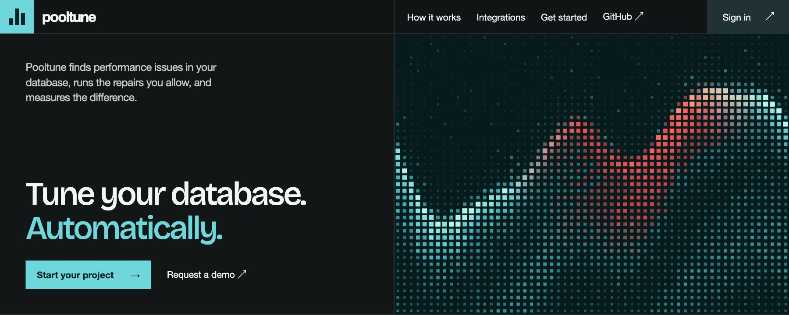
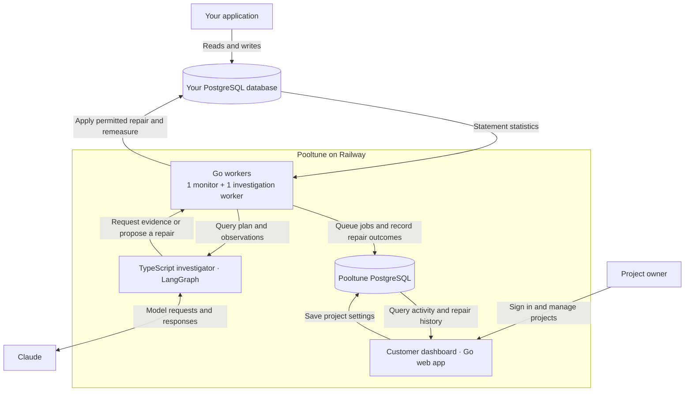

# Pooltune

<a href="https://pooltune.up.railway.app/#how"></a>

<p align="center">
  <a href="https://go.dev/"></a>
  <a href="https://www.typescriptlang.org/"></a>
  <a href="https://docs.langchain.com/oss/javascript/langgraph/overview"></a>
  <a href="https://www.postgresql.org/"></a>
  <a href="https://supabase.com/"></a>
  <a href="https://railway.com/"></a>
</p>

<p align="center"><a href="https://pooltune.up.railway.app/#how"><b>Try the interactive walkthrough</b></a> · <a href="https://pooltune.up.railway.app/signin">Open workspace</a></p>

Pooltune is a PostgreSQL tuning agent. It investigates expensive queries and database bottlenecks, runs repairs you allow, and measures the same workload again to see what changed. You can also run it in monitor-only mode.

The walkthrough is public. Today, the hosted workspace connects to PostgreSQL databases on Supabase. Create a free account with email or Google to connect yours. Each free account gets a one-time $0.25 AI budget shared across up to five projects. Each model request also uses one of 50 credits that renew each UTC calendar month. All demo accounts draw from the same $45 lifetime fund. Monitoring continues when a limit is reached.

## Repair tools and measured results

Each row shows one controlled PostgreSQL staging trial with synthetic traffic. Times are mean database execution times for the affected query. Each project owner chooses which of the six repairs to allow, and the database role must have the required privileges.

| Repair tool | Bottleneck and fix | Before → after |
| --- | --- | ---: |
| Add a two-column index | A lookup scanned 100,000 rows to find one match. A compound index reduced that to one row examined. | [11.370 → 0.036 ms](docs/design/hosted-query-agent/evidence/repair-expansion/compound-20261114-201546.json) |
| Refresh stale statistics | PostgreSQL expected 106,720 rows for a lookup that returned one. After `ANALYZE`, it estimated one row and used the existing index. | [10.260 → 0.024 ms](docs/design/hosted-query-agent/evidence/repair-expansion/analyze-20261114-195906.json) |
| Collect joint column statistics | The planner misjudged how often two filter values occurred together. For one input returning 100 rows, joint statistics brought its estimate from 24,883 rows to 120. | [13.520 → 0.276 ms](docs/design/hosted-query-agent/evidence/repair-expansion/statistics-20261114-200207.json) |
| Vacuum a table | After updates, an index-only scan still fetched 50,000 rows from the table to check visibility. A targeted `VACUUM` reduced those fetches to zero. | [38.844 → 8.627 ms](docs/design/hosted-query-agent/evidence/repair-expansion/vacuum-20261114-200629.json) |
| Tune function memory | A sort spilled to disk. Raising the memory allowance for that function brought temporary writes from 14 MiB to zero. | [220.592 → 147.383 ms](docs/design/hosted-query-agent/evidence/repair-expansion/memory-20261114-200950.json) |
| Reschedule a background job | A recurring job competed with foreground queries. Pooltune moved it to an approved quiet window and verified the next three runs. Times cover 120 busy-period calls on each side. | [35.261 → 0.086 ms](docs/design/hosted-query-agent/evidence/repair-expansion/cron-20261114-220423.json) |

[Trial methodology and coverage](docs/design/hosted-query-agent/repair-expansion.md#live-results)

## A repair from start to finish

In a separate controlled index trial, an application looked up records by customer and category. To find the matching rows, PostgreSQL touched 866 blocks. Pooltune identified that the two filters could share an index. With index creation enabled, it built that index while application reads and writes continued.

| What Pooltune measured | Before the index | After the index |
| --- | ---: | ---: |
| Block accesses for the same lookup input | 866 | 4 |
| Database execution time for that input | 16.605 ms | 0.070 ms |
| Average time seen by the client across candidate calls | 41.85 ms | 24.36 ms |

The database measurement shows how much work the lookup saved. The client measurement includes the rest of the round trip. The index added about 3.45 MiB of storage. The trial also recorded timings for writes and a healthy query so you can inspect what happened to other traffic. [See the recorded trial](docs/design/hosted-query-agent/evidence/mvp-simple-index-railway.json)

## Inside the workspace

The customer dashboard is the signed-in workspace served by Pooltune’s Go web app. [Open the dashboard](https://pooltune.up.railway.app/app)

1. **Connect a project.** Choose the allowed repairs, connect your database, and review the permissions you granted. You can manage several projects from one account.
2. **Follow the workload.** Overview shows monitoring checks and observed query activity. A monitoring check is one sample taken by the agent. Query calls count work the application actually ran.
3. **Inspect a change.** Open Change history to see the repair and its measured outcome. You can revert an eligible index there, pause the agent from the project header, or adjust its permissions for future repairs.

## System architecture



With investigations enabled, each project runs two main Go workers. One samples query activity while the other handles one investigation at a time. LangGraph and Claude compare possible causes. Go checks permissions, applies an allowed repair, and measures the result. [Hosted supervisor](internal/hostedapp/supervisor.go)

## Technical trade-offs

- **Go executes repairs.** Keeping LangGraph in TypeScript adds a second runtime to deploy. Go can check every proposed operation against the database role and project permissions before it runs. [Backend decision](docs/product/backend-language-decision.md)
- **Sample existing traffic.** PostgreSQL’s statement counters let us measure blocks touched per call without rerunning customer queries. Those counts alone can’t identify which step in the query plan did the work. [Measurement design](docs/design/hosted-query-agent/observed-page-access.md)
- **Send index evidence up front.** Including the query plan and existing-index check makes the first prompt larger and saves a model round trip. Across six paired replays of one lookup, median investigation time fell from 2.56 s to 1.61 s. [Replay results](docs/design/hosted-query-agent/index-slice.md#one-claude-request-versus-two)
- **Record intent before changing the database.** Each repair adds a PostgreSQL write. After a restart, the worker can check whether an interrupted operation completed before deciding whether to retry. [Recovery design](docs/design/hosted-query-agent/overview.md#why-the-worker-remembers-unfinished-work)

## What's next

- **More PostgreSQL deployments.** Add a direct connection for self-hosted PostgreSQL, then test other managed providers. For each environment, verify which statistics the agent can read and which repairs its database role can run.
- **Explore MongoDB.** Start with one slow lookup in a document database. Use MongoDB’s query plan to identify a candidate index, then compare how many documents the same lookup examines before and after.

<details>
<summary>Run the tests</summary>

```sh
go test ./...
npm --prefix investigator ci
npm --prefix investigator test
```

With PostgreSQL 17 binaries on your PATH, run the database integration tests with `go test -tags=integration ./internal/hostedquery ./cmd/pooltune-query-lab -count=1`.

</details>
