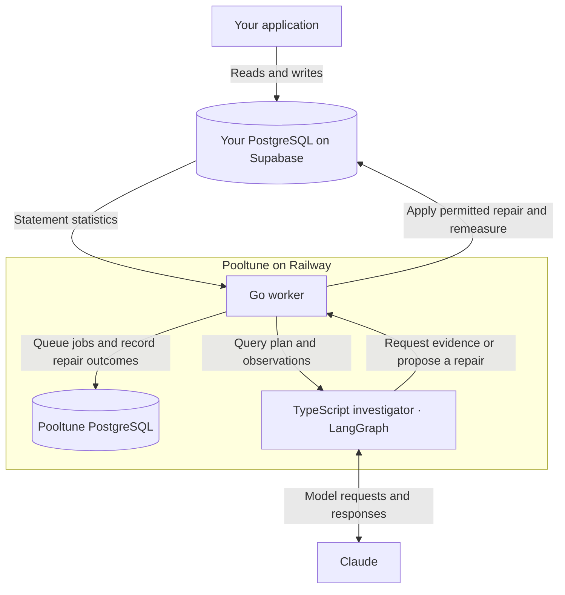

# Pooltune

<a href="https://pooltune.up.railway.app/#how"></a>

<p align="center">
  <a href="https://go.dev/"></a>
  <a href="https://www.typescriptlang.org/"></a>
  <a href="https://docs.langchain.com/oss/javascript/langgraph/overview"></a>
  <a href="https://www.postgresql.org/"></a>
  <a href="https://supabase.com/"></a>
  <a href="https://railway.com/"></a>
</p>

<p align="center"><a href="https://pooltune.up.railway.app/#how"><b>Try the interactive walkthrough</b></a> · <a href="https://pooltune.up.railway.app/signin">Open workspace</a></p>

Pooltune is a tuning agent for developers running PostgreSQL on Supabase. When a query starts doing more work than it used to, Pooltune investigates the cause, runs a repair you have allowed, and measures the same work again. You can also connect a project in monitor-only mode. The walkthrough is public. Create a free account with email or Google to connect your database. Each free account gets a one-time $0.25 AI budget shared across up to five projects. Each model request also uses one of 50 credits that renew each UTC calendar month. All demo accounts draw from the same $45 lifetime fund. Monitoring continues when a limit is reached.

## A repair from start to finish

In a controlled PostgreSQL test, an application looked up records by customer and category. To find the matching rows, PostgreSQL touched 866 blocks. Pooltune identified that the two filters could share an index. With index creation enabled, it built that index while application reads and writes continued.

| What Pooltune measured | Before the index | After the index |
| --- | ---: | ---: |
| Block accesses for the same lookup input | 866 | 4 |
| Database execution time for that input | 16.605 ms | 0.070 ms |
| Average time seen by the client across candidate calls | 41.85 ms | 24.36 ms |

The database measurement shows how much work the lookup saved. The client measurement includes the rest of the round trip. The index added about 3.45 MiB of storage. The trial also recorded timings for writes and a healthy query so you can inspect what happened to other traffic. [See the recorded trial](docs/design/hosted-query-agent/evidence/mvp-simple-index-railway.json)

## What you can let Pooltune change

Each project has six independent permissions. Enabling one lets the worker consider that operation. The database role still needs access to the target, and the worker checks the evidence before acting.

| Permission | When it helps |
| --- | --- |
| Add indexes | A frequent, selective lookup reads many blocks to find a few rows. A nonunique index can give it a shorter path. |
| Refresh statistics | After a table changes, the planner may still use old estimates. Refreshing its statistics gives it a current picture of the data. |
| Improve statistics detail | Two columns often occur together, or one value is unusually common. More detailed statistics can help the planner estimate how many rows will match. |
| Maintain tables | Updates and deletes leave old row versions behind. A targeted cleanup can reclaim space for reuse within the table. |
| Tune function memory | A sort inside a selected function spills to disk. A bounded memory adjustment can keep that work in memory. |
| Reschedule jobs | A recurring background job competes with application traffic. Pooltune can move it within an approved window and check future executions. |

All six repair families have controlled staging cases. The linked trials document the workloads and permissions exercised for each. [Repair evidence and current coverage](docs/design/hosted-query-agent/repair-expansion.md)

## Inside the workspace

1. **Connect a project.** Choose the allowed repairs, connect your Supabase database, and review its access. You can manage several projects from one account.
2. **Follow the workload.** Overview shows monitoring checks and observed query activity. A monitoring check is one sample taken by the agent. Query calls count work the application actually ran.
3. **Inspect a change.** Open Change history to see the repair and its measured outcome. You can revert an eligible index there, pause the agent from the project header, or adjust its permissions for future repairs.

## System architecture



The application keeps talking directly to PostgreSQL. A Go worker samples database statistics in the background and queues an investigation when it sees repeated expensive work. A TypeScript workflow built with LangGraph gives Claude the query plan and supporting observations. It can request more evidence, propose a supported repair, or close the investigation.

Go checks the proposed target, permissions, and operating limits before running the repair. It records the intended change in PostgreSQL so a restarted worker can check what happened before trying again. Verification compares the affected work and, where available, checks other traffic for regressions. [Engineering overview](docs/design/hosted-query-agent/overview.md) · [Original connection-pool gateway](legacy/README.md)

## Technical trade-offs

- **Go executes repairs.** Keeping LangGraph in TypeScript adds a second runtime to deploy. Go can check every proposed operation against the database role and project permissions before it runs. [Backend decision](docs/product/backend-language-decision.md)
- **Sample existing traffic.** PostgreSQL’s statement counters let us measure blocks touched per call without rerunning customer queries. Those counts alone can’t identify which step in the query plan did the work. [Measurement design](docs/design/hosted-query-agent/observed-page-access.md)
- **Send index evidence up front.** Including the query plan and existing-index check makes the first prompt larger and saves a model round trip. Across six paired replays of one lookup, median investigation time fell from 2.56 s to 1.61 s. [Replay results](docs/design/hosted-query-agent/index-slice.md#one-claude-request-versus-two)
- **Record intent before changing the database.** Each repair adds a PostgreSQL write. After a restart, the worker can check whether an interrupted operation completed before deciding whether to retry. [Recovery design](docs/design/hosted-query-agent/overview.md#why-the-worker-remembers-unfinished-work)

<details>
<summary>Run the tests</summary>

```sh
go test ./...
npm --prefix investigator ci
npm --prefix investigator test
```

With PostgreSQL 17 binaries on your PATH, run the database integration tests with `go test -tags=integration ./internal/hostedquery ./cmd/pooltune-query-lab -count=1`.

</details>
