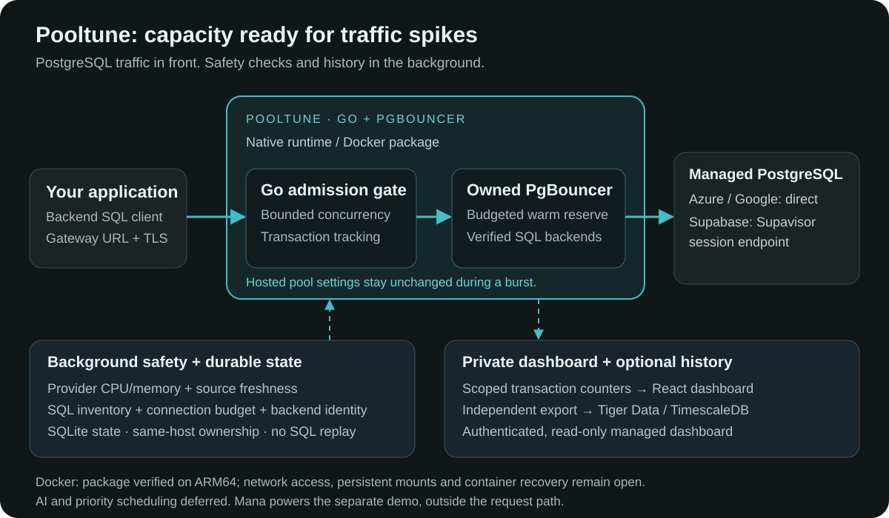
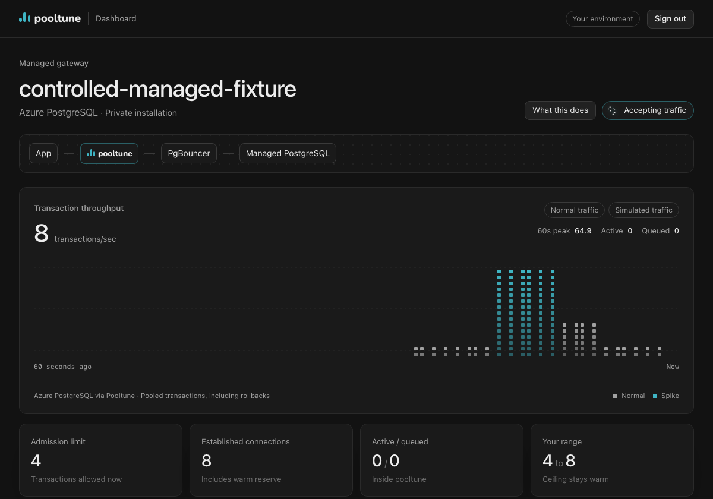

# Pooltune

**Automatic transaction admission for PostgreSQL traffic spikes.**

Pooltune keeps a budgeted reserve of database connections warm, then adjusts how many transactions can run as demand changes. It checks database health and connection inventory before admitting more work, and shows the result in a private dashboard.

[Website](https://pooltune.vercel.app) · [Setup guide](https://pooltune.vercel.app/setup.html) · [Download for macOS](https://pooltune.vercel.app/downloads/pooltune-macos-arm64.tar.gz) · [Interactive demo](https://www.mana.space/a/pooltune)

## Architecture



Your backend application sends **PostgreSQL traffic over TLS** to the Go gateway. It admits transactions through an owned PgBouncer warm reserve. Provider health, source freshness and SQL inventory gate expansion. SQLite records local state; the private React dashboard reads scoped counters, and an independent worker optionally saves history to Tiger Data. Mana powers the separate interactive demo.

**Docker packaging is now in this repository.** The Linux ARM64 runtime bundles the Go gateway, owner CLI, PgBouncer and dashboard assets as a non-root image. Its real SQL verification runs in a separate disposable container. Application/dashboard networking, persistent mounts and container crash/restart verification remain open, so this is a **Docker learning preview**, not yet a complete managed deployment. [Build and verify it](deploy/docker/README.md).

The diagram describes the managed route. The separate local background tuner observes and adjusts an existing PgBouncer. It is included in the native archive, not in the current Docker runtime image.



*Dashboard preview with explicitly simulated traffic. Live provider test results are summarized below.*

## What it does

- Adjusts transaction admission within an approved floor and ceiling while keeping a warm reserve ready.
- Checks provider CPU/memory signals, their original timestamps, backend identity and the complete connection budget.
- Shows measured transactions/sec, queue depth, admission limits, established connections and provider health in an authenticated dashboard.
- Saves optional traffic history to **Tiger Data**, with one-minute averages and peaks across dashboard visits.

The managed route is:

```text
Application → Pooltune gateway → Pooltune-owned PgBouncer → Managed PostgreSQL
```

Applications use the gateway's connection URL. The local background-tuner mode is separate and keeps the application's existing pooler URL.

## Built with Tiger Data and Mana

### Tiger Data: persistent time-series history

Tiger Data is the storage layer behind the optional **View history** panel on both private dashboards. Pooltune writes scoped transaction counts, derived throughput and pool measurements into a Timescale hypertable, then queries the last hour with `time_bucket`.

- **Correct rates:** cumulative counters retain exact 64-bit precision. Minute averages use transaction deltas divided by measured elapsed time; peaks retain the highest sampled rate.
- **Honest gaps:** counter resets, process changes and stale readings establish a new baseline. Missing intervals are not filled with invented traffic.
- **Independent export:** a separate worker and bounded database connections keep history failures out of the admission path.
- **Private by default:** verified TLS, a private connection file, authenticated reads and a distinct stream per installation. SQL text, database credentials and target names are excluded from the exported fields.

Live Tiger Data checks verified hypertable creation, idempotent inserts, aggregation, persistence through reconnects and separation between streams. Browser checks verified saved history after reload on both dashboards. Configuration is documented in `docs/traffic-history.md` inside the download. Raw-data retention is owner-managed.

### Mana: an interactive product demo and submission video

[The Mana demo](https://www.mana.space/a/pooltune) turns the product into a five-scene walkthrough: the spike problem, gateway architecture, private dashboard, measured results and setup.

Mana was used to build the interactive scenes, provider switcher, spike controls and narrated playback, combining the existing dashboard recording with the recorded Azure, Google Cloud and Supabase results. It also produced the standalone **three-minute, 1080p narrated MP4** by recording the walkthrough and combining its existing narration with FFmpeg.

The demo labels illustrative animation, sample dashboard traffic and recorded provider measurements separately. Mana viewers may need to sign in.

## Engineering behind the MVP

The hard part is deciding when another transaction can safely run, while distinguishing usable capacity from connections that merely exist.

| Challenge | Implementation |
| --- | --- |
| Reacting to a spike | Prepare connections before the spike and change transaction admission within the approved budget. Hosted pool settings stay unchanged during the burst. |
| Different managed providers | Azure and Google use direct managed PostgreSQL; Supabase uses its stable session endpoint. Each path has its own pressure source, freshness limits and connection checks. |
| Verifying warm capacity | Check authentication, distinct PostgreSQL backends, complete inventory and budget. Google readiness accounts for PgBouncer's established used/tested states. |
| Delayed cloud metrics | Preserve source timestamps and stop admission when evidence expires. SQL inventory is checked independently; optional traffic polling cannot refresh a safety timestamp. |
| Cancellation and uncertain outcomes | Retain reservations for unknown transaction outcomes until reconciliation. Failed SQL is never replayed automatically. |
| Measuring actual traffic | Read the exact database's `SHOW STATS.total_xact_count` through separate, time-bounded connections. The counter measures pooled transactions, including rollbacks, rather than HTTP requests or individual SQL statements. |
| Private operations | File-based secrets, verified TLS, an authenticated local dashboard and a same-host ownership lock. The managed dashboard is read-only; the CLI starts admission and drains on shutdown. |

**Stack:** Go, PostgreSQL protocol handling, PgBouncer, SQLite for local durable state, React/TypeScript/Vite, Tiger Data/TimescaleDB, Docker/Compose with Colima on macOS, Mana and Vercel.

## Provider coverage

| Target | Current MVP path | Verified evidence |
| --- | --- | --- |
| Azure Database for PostgreSQL | Owned PgBouncer → direct managed PostgreSQL | Live adaptive spike run, with provider health and inventory checks |
| Google Cloud SQL for PostgreSQL | Owned PgBouncer → direct managed PostgreSQL | Live adaptive spike run after the readiness correction |
| Supabase | Owned PgBouncer → stable Supavisor session endpoint | Live adaptive spike run without resizing Supavisor during traffic |
| Local PostgreSQL / PgBouncer | Background tuner and scoped pool telemetry | Real PostgreSQL/PgBouncer correctness checks and private dashboard tests |

These results verify the gateway paths above. They do not certify native Azure/Google managed-pool resizing or live Supavisor resizing.

## Recorded spike results

Each trial offered 60 seconds of synthetic traffic against a real managed database. This table compares completed transactions during the first ten-second spike:

| Provider | Smaller fixed pool | Pooltune adaptive | Equally large warm fixed pool | Adaptive successful p95 |
| --- | ---: | ---: | ---: | ---: |
| Azure | 1,956 / 3,000 | **2,476 / 3,000** | 2,469 / 3,000 | 694.561 ms |
| Google Cloud | 2,284 / 3,000 | **2,853 / 3,000** | 2,863 / 3,000 | 582.992 ms |
| Supabase | 208 / 300 | **300 / 300** | 300 / 300 | 246.445 ms |

Pooltune completed more work than the smaller fixed pools and performed comparably to an equally sized warm pool. Its demonstrated value is automatic admission within approved bounds with a prepared reserve. Superiority over a well-sized fixed warm pool and lower cloud bills are not established.

These are separate synthetic trials, not randomized estimates or production guarantees. Successful p95 excludes failed/rejected requests. See the [full workload, failures and comparison boundaries](https://pooltune.vercel.app/downloads/managed-mvp-results.md).

## Get started

### Docker learning preview

With Docker Engine, Buildx and Compose available:

```sh
git clone https://github.com/jyshum/pooltune.git
cd pooltune
docker build --target runtime -t pooltune:learning .
docker compose -f compose.verify.yaml run --build --rm verify
docker run --rm --network none pooltune:learning -help
```

These commands build the runtime, verify real SQL locally and show its interface. They do not launch a configured managed service. No credentials or cloud database are needed for verification. Linux ARM64 is verified; AMD64 is not yet verified. On macOS with Docker CLI + Colima, follow [the Colima setup](deploy/docker/README.md#docker-cli--colima-on-macos). No prebuilt registry image is published.

### Native managed gateway

The current native preview targets **macOS Apple Silicon** and requires PgBouncer 1.26.1 on `PATH`.

```sh
curl -fLO https://pooltune.vercel.app/downloads/pooltune-macos-arm64.tar.gz
curl -fLO https://pooltune.vercel.app/downloads/pooltune-macos-arm64.tar.gz.sha256
shasum -a 256 -c pooltune-macos-arm64.tar.gz.sha256
tar -xzf pooltune-macos-arm64.tar.gz
```

Follow the [setup guide](https://pooltune.vercel.app/setup.html) to create a private provider profile, set the connection budget and launch the gateway/dashboard. The [detailed gateway guide](https://pooltune.vercel.app/downloads/managed-setup-guide.md) covers credentials, certificates, provider differences and recovery. Keep secrets outside the extracted UI and repository.

The archive includes `pooltune-burst`, the local tuner, private dashboard assets and the optional Tiger Data history guide. Startup stays frozen unless explicitly resumed after its checks pass.

## Current boundaries

- The MVP listener and dashboard are loopback-only. Remote deployments need separately verified private routing.
- There is no automatic backup routing, transparent crash recovery, distributed fencing or SQL replay. Backend replacement and uncertain outcomes can require operator reconciliation.
- The managed path retains its physical warm reserve. Physical connection reclamation and cloud-bill savings are not demonstrated.
- COPY, suspended portals, long-running production validation and broader query mixes remain outside the verified protocol/workload scope.
- AI-driven tuning and business-priority scheduling are deferred. The current admission controller is deterministic.

## Release and source status

Use the [current preview release](https://github.com/jyshum/pooltune/releases/tag/managed-history-preview-2026-10-25) for the downloadable MVP. Its package, checksums and startup were verified separately from the cloud test runner.

The current MVP backend, private dashboard and Tiger Data history implementation are now included on `main`. The existing downloadable archive was built before this source publication; its `RELEASE.json` correctly retains the original source HEAD and dirty development-build status. Its historical release tag identifies the website snapshot. Publishing the source does not retroactively change that artifact or its provenance. Older design documents describe earlier or deferred work; the current scope is summarized above and in [the managed MVP results](docs/managed-mvp-results.md).

## Build from source

Use Go 1.27.3 and a Node.js version supported by Vite 8. PgBouncer 1.26.1 is needed to run the managed gateway.

```sh
git clone https://github.com/jyshum/pooltune.git
cd pooltune
npm ci
npm --prefix ui ci
npm --prefix ui run build
go build -o bin/pooltune-burst ./cmd/pooltune-burst
go build -o bin/pooltune-tuner ./cmd/pooltune-tuner
```

Follow [the gateway guide](docs/burst-gateway.md) for a private provider profile, credentials and launch flags. Optional history setup is in [the Tiger Data guide](docs/traffic-history.md). To build the complete native archive, run `scripts/package-local.sh /absolute/path/to/new-package` with a destination that does not exist.

Local checks, without starting paid cloud tests:

```sh
go test -race ./cmd/... ./internal/...
go vet ./cmd/... ./internal/...
npm run test:sdk
npx vitest run ui/src/traffic.test.ts
```
